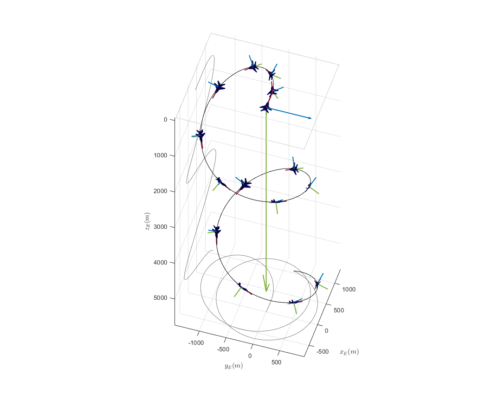
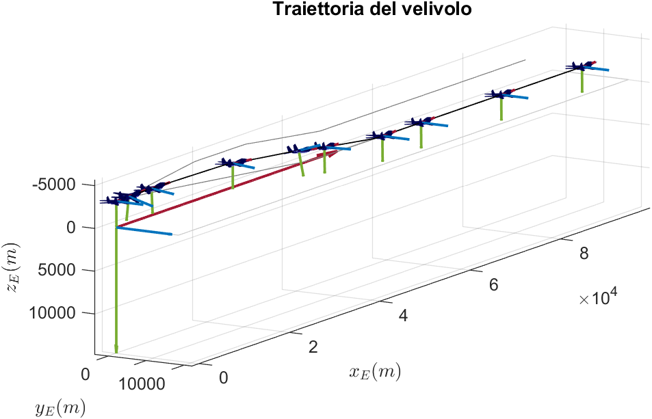
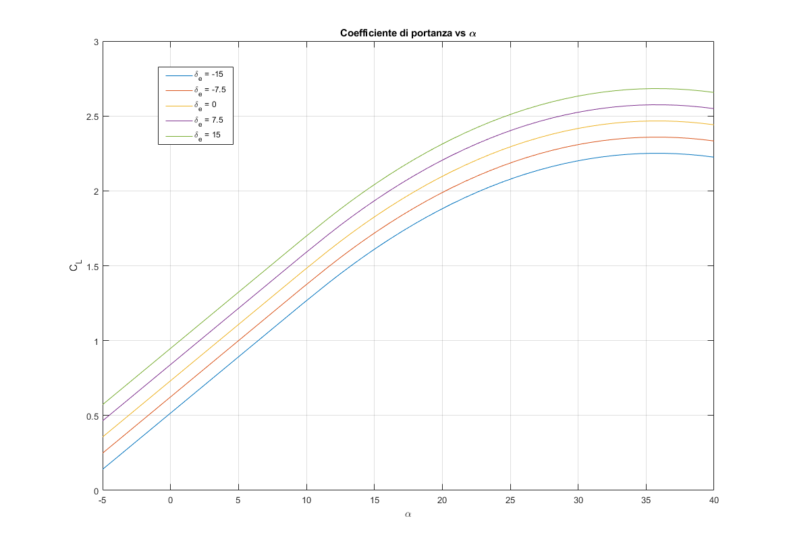
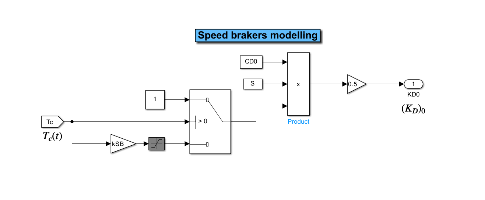
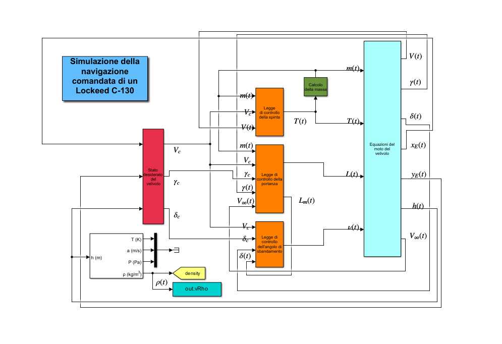
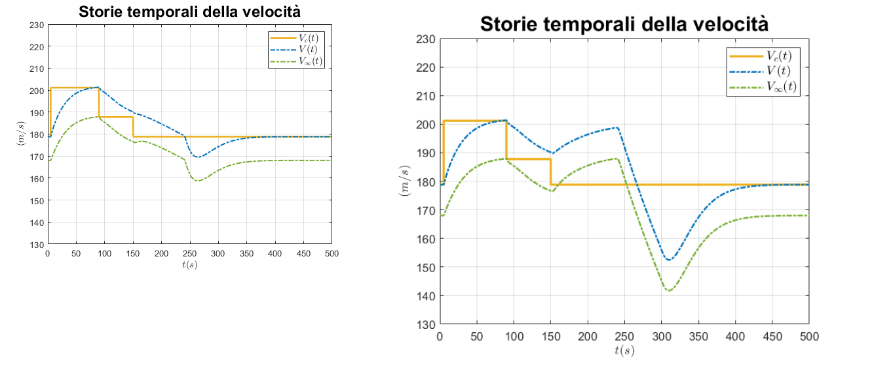

# Flight Dynamics & Simulation | MATLAB & Simulink
### Aircraft Dynamics, 6-DoF Modelling & Numerical Flight Simulation

**University of Naples Federico II · Aerospace Engineering · Academic Year 2023–2024**  
MATLAB · Simulink · Rigid-Body Dynamics · Trim Optimization · Flight Stability · Aerodynamic Modelling

> An engineering study of aircraft flight dynamics, from kinematics and equations of motion to numerical simulation and dynamic stability. Two investigations receive particular attention: **F/A-18 HARV constrained 6-DoF trim and trajectory analysis**, and **speed-brake modelling within a Simulink controlled-flight model**.

**[Complete technical report (PDF)](Report/Flight_Dynamics_and_Simulation_Di_Rosa_2023-2024.pdf)** · **[HARV MATLAB project](HARV_6DoF/)** · **[Speed-brake Simulink project](Speed_Brakes/)**

<table align="center">
  <tr>
    <td width="50%" align="center" valign="middle">
      
    </td>
    <td width="50%" align="center" valign="middle">
      
    </td>
  </tr>
</table>
<p align="center"><sub>F/A-18 HARV constrained-trim trajectory and controlled-flight trajectory with speed brakes.</sub></p>
## Project overview

This repository documents my *Flight Dynamics and Simulation* project at the **University of Naples Federico II**, undertaken as part of the Aerospace Engineering programme. The accompanying [148-page report](Report/Flight_Dynamics_and_Simulation_Di_Rosa_2023-2024.pdf) combines theoretical derivations with MATLAB and Simulink exercises to investigate aircraft motion, equilibrium, control response and stability.

The work progresses from reference frames and aircraft kinematics to nonlinear flight dynamics, constrained trim, numerical integration and small-perturbation analysis. The foundations are based on the course material developed by **Prof. Agostino De Marco**; the report and the two investigations below develop and explore these topics in greater detail.

### Scope of the report

| Area | Main topics |
|:--|:--|
| **Kinematics** | Body and Earth frames, Euler angles, quaternions and attitude representation |
| **Equations of motion** | Rigid-body aircraft dynamics, 3-DoF and 6-DoF formulations, aerodynamic forces and moments |
| **Controlled flight** | Commanded flight conditions, control laws, Simulink modelling and numerical response |
| **Trim and equilibrium** | Aircraft operating points, numerical optimization and equilibrium constraints |
| **Stability** | Longitudinal and lateral-directional modes, including phugoid, short-period, Dutch roll and spiral motion |
| **Control surfaces** | Locked/free controls and hinge-moment effects |

---

## 1. F/A-18 HARV — 6-DoF trim and trajectory analysis

This investigation studies a **six-degree-of-freedom F/A-18 HARV** (*High Angle-of-Attack Research Vehicle*) model, with particular attention to a constrained equilibrium condition at **non-zero sideslip**. It connects an aerodynamic model, a nonlinear trim search and subsequent time-domain propagation.

### Engineering approach

- **Aerodynamic model:** piecewise coefficient functions for lift, drag, side force, roll, pitch and yaw moments.
- **6-DoF trim search:** MATLAB `fmincon` minimizes six equations-of-motion residuals over seven parameters: airspeed, angle of attack, sideslip, aileron, elevator, rudder and throttle.
- **Crabbing-inspired case:** the investigation fixes the sideslip angle at **β = 2°**, with zero initial angular rates, to explore a non-symmetric equilibrium condition.
- **Numerical flight simulation:** `ode45` propagates a **13-state nonlinear model**, using quaternions to represent aircraft attitude.
- **Further analysis:** aerodynamic-coefficient inspection and an approximate spiral-mode calculation help interpret the motion.

**Source code:** [Trim6DoF.m](HARV_6DoF/Trim6DoF.m) · [Trim objective function](HARV_6DoF/costLongEquilibriumStaticStickFixed6DoF_Valphabetapqr.m) · [Quaternion-based equations of motion](HARV_6DoF/eqLongDynamicStickFixed_6DoF_Valphabetapqr_quat.m) · [Aerodynamic functions](HARV_6DoF/Aerodynamics/)

### Results — Spiral-like flight path


*Figure 1 — F/A-18 HARV trajectory, from Fig. 6.16 of the report (p. 146).*

The constrained optimization produced a **candidate rather than an exact trim solution**. With this candidate as the initial condition, the nonlinear simulation generated a pronounced spiral-like trajectory. The report also evaluates a simplified spiral-mode estimate (**λ_spiral ≈ −0.0034**).

The resulting path is a useful case study in **trim sensitivity and numerical interpretation**: it does not by itself demonstrate an unstable spiral mode or a completed crosswind-crabbing manoeuvre. The experiment concerns a prescribed sideslip angle rather than a fully modelled wind-compensating approach.

### Aerodynamic-coefficient analysis



*Figure 2 — Example of the aerodynamic model inspection documented in Chapter 6 (report p. 129).*

A complementary 6-DoF study based on Euler-angle kinematics and time-dependent control-surface inputs is available in [Additional_Maneuver](HARV_6DoF/Additional_Maneuver/).

---

## 2. Speed brakes — Simulink aircraft model

The second investigation extends a **controlled-flight Simulink model** with a simplified speed-brake/spoiler representation. The objective is to investigate how additional aerodynamic braking affects speed regulation and the aircraft's longitudinal response.

A key modelling constraint is that the propulsion system cannot supply negative thrust. When the flight controller requests negative thrust, the command is limited to zero and the speed-brake logic adds **aerodynamic drag**, together with a **lift-related angle-of-attack correction** representative of a spoiler-like configuration.

### Simulink model



*Figure 3 — Additional speed-brake drag contribution in Simulink (report Fig. 2.10, p. 37).*



*Figure 4 — Controlled-flight Simulink model (report Fig. 2.1, p. 31).*

### Results — Aircraft response with and without speed brakes



*Figure 5 — Documented velocity histories for the two configurations (report Figs. 2.19–2.20, p. 44).*

The comparison illustrates how the additional aerodynamic braking changes the simulated deceleration and subsequent speed response under a common sequence of flight commands. It is an **academic modelling comparison**, not an experimentally calibrated performance claim.

The [Speed_Brakes](Speed_Brakes/) folder contains the **Simulink model, MATLAB setup and result-processing scripts**. Its configurable parameters and execution steps are documented in the [speed-brake technical notes](Speed_Brakes/README.md).

---

## Running the models

Open MATLAB with the repository as the current folder and add the MATLAB paths:

```matlab
setup_paths
```

**HARV constrained trim:**

```matlab
cd HARV_6DoF
Trim6DoF
```

**Speed-brake simulation** (from the repository root):

```matlab
cd Speed_Brakes
setup_speed_brakes
out = sim('nape_speed_brakes');
plot_speed_brakes_results
```

The HARV model uses MATLAB with Optimization Toolbox and Aerospace Toolbox. The speed-brake model additionally uses Simulink and Aerospace Blockset. See the [HARV technical notes](HARV_6DoF/README.md) and [speed-brake technical notes](Speed_Brakes/README.md) for requirements and known numerical checks.

## Repository structure

```text
flight-dynamics-and-simulation/
├── README.md
├── setup_paths.m               MATLAB path setup
├── Report/                     Full academic report (PDF)
├── HARV_6DoF/                  Trim, 6-DoF dynamics and aerodynamic functions
│   ├── Aerodynamics/           Aerodynamic coefficient functions
│   └── Additional_Maneuver/    Euler-angle 6-DoF manoeuvre
├── Speed_Brakes/               Simulink model, setup and analysis scripts
└── Images/                     Figures from the technical report
```

## Scope and interpretation

This is an **academic numerical study**. The figures illustrate the scenarios and results discussed in the technical report. The HARV trim search is exploratory, and the speed-brake investigation uses a simplified aerodynamic model. Model assumptions and numerical considerations are described in the project-specific technical notes.

## Authors and academic credits

- **[Vincenzo Junior Di Rosa](https://github.com/vincenzodirosaj)** — author of the report and project investigations, including the HARV constrained-trim study and the Simulink speed-brake extension.
- **Andrea Raia** — credited in the `DSVAircraft.m` MATLAB source used in the aircraft modelling exercises.
- **[Prof. Agostino De Marco](https://github.com/agodemar)** — course instructor and author of the underlying teaching resources; credited in the aircraft-visualization utilities included in this repository.

The work builds upon the **Flight Dynamics and Simulation** course at the University of Naples Federico II. Academic materials and helper code are acknowledged according to their respective sources; their inclusion does not imply that all three contributors co-authored the report or each file.

**References:** [Course material — DSV/DQV](http://wpage.unina.it/agodemar/DSV-DQV/) · [Aircraft-Type-Specific Impact of Speed Brakes on Lift and Drag (2022)](https://doi.org/10.3390/aerospace9050263)

---

**Project report:** Vincenzo Junior Di Rosa · University of Naples Federico II · 2023–2024
